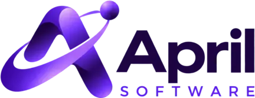

<p align="center">
  
</p>

<p align="center">
  
</p>

<h1 align="center">April Writer</h1>

<p align="center">
  <b>A local-first word processor for writing and document design.</b>
</p>

<p align="center">
  April Writer is part of April Office and is developed by
  <a href="https://www.aprilsoftware.com">April Software S.A.</a>
</p>

> [!IMPORTANT]
> April Writer is alpha software. It is not yet presented as production-ready and does not claim
> complete compatibility with Microsoft Office. Keep backups of important documents and qualify
> the formats and workflows your organization depends on.

## Overview

April Writer is a native, open-source word processor derived from WordCraft. It combines a
ribbon-style editing workflow with document styles, tables, comments, tracked changes,
references, mail merge, printing and export. Its document engine is written in Rust and is also
used by the command-line and automation interfaces.

The April distribution is intentionally independent:

- application name: **April Writer**
- executables: `aprilwriter` and `aprilwriter-cli`
- application ID: `com.aprilsoftware.aprilwriter`
- protocol and browser-storage namespace: `aprilwriter`
- isolated preferences, recovery data, dictionaries, templates and logs
- upstream update checks disabled until an April-controlled signed update channel exists

## Current capabilities

April Writer currently supports common writing and document-design work including:

- paragraphs, character formatting, lists, sections and page setup
- tables, pictures, shapes, headers, footers, fields and symbols
- styles, navigation, comments and tracked revisions
- references, footnotes, endnotes, citations and mail merge
- spelling, grammar, hyphenation and speech-related tools
- import and export for DOCX and several interchange or publishing formats
- PDF and image export
- command-line conversion, inspection and scripted document operations
- MCP and local desktop-control interfaces for approved automation workflows

Format fidelity varies by document feature. Complex charts, SmartArt, macros, exact pagination and
other advanced Office behavior require workflow-specific testing.

## Build from source

The repository keeps its established internal Cargo package and crate names so upgrades remain
manageable. Customer-facing binaries use April names.

Requirements include a current stable Rust toolchain and the native libraries required by winit,
wgpu, audio, printing and font discovery on the target platform.

```sh
git clone https://github.com/aprilsoftware/wordcraft.git
cd wordcraft

# Desktop application with the built-in sample document
cargo run --release -p wordcraft -- --sample

# Command-line interface
cargo run --release -p wordcraft-cli -- --help
```

For repository checks:

```sh
cargo fmt --all -- --check
cargo test --workspace --locked
cargo xtask assets
```

Some control-server and MCP tests open loopback sockets. Run those in an environment that permits
local networking.

## Installed commands

```sh
aprilwriter report.docx
aprilwriter-cli convert report.docx report.pdf
aprilwriter-cli text report.docx
aprilwriter-cli inspect report.docx
aprilwriter-cli mcp
```

The built-in file browser remains available as a native-dialog fallback and for controlled
automation. Set `APRILWRITER_FILE_DIALOG=builtin` when it must be selected explicitly.

## Application data

April Writer does not automatically import or fall back to a WordCraft profile.

| Platform | Default profile directory |
|---|---|
| Linux and BSD | `$XDG_CONFIG_HOME/aprilwriter` or `~/.config/aprilwriter` |
| macOS | `~/Library/Application Support/April Writer` |
| Windows | `%APPDATA%\April Writer` |

Set `APRILWRITER_PROFILE_DIR` to use an explicit profile directory. Logs are written beneath that
profile as `aprilwriter.log`, `aprilwriter.1.log` and `aprilwriter.2.log`.

New documents default to the author name `April Writer User`. Only the exact former experimental
default `WordCraft User` is migrated in April preferences; custom author names and authors stored
inside existing documents are preserved.

## Packaging identity

Packaging work is being qualified incrementally. The intended native artifact names are:

- Linux: `aprilwriter-<version>-linux-<architecture>.*`
- Windows: `aprilwriter-<version>-windows-<architecture>.msi` and portable ZIP
- macOS: `aprilwriter-<version>-macos-<architecture>.dmg`
- macOS CLI: `aprilwriter-cli-<version>-macos-<architecture>.zip`

A filename here is an identity contract, not a release-readiness claim. Release artifacts require
platform-specific signing, installation and compatibility qualification.

## Repository layout

| Path | Purpose |
|---|---|
| `apps/wordcraft` | April Writer desktop application; internal package name retained |
| `apps/wordcraft-cli` | command-line and MCP application |
| `apps/wordcraft-web` | WebAssembly shell under active qualification |
| `crates/engine` | session, command and document lifecycle engine |
| `crates/ui-egui` | native and web user interface |
| `crates/docx`, `crates/formats` | document import and export |
| `packaging/` | platform package definitions and reproducible asset generation |

Internal `wordcraft-*` crate and module names are implementation identifiers, not customer-facing
product names.

## Support

There is no approved public issue tracker for April Writer. Contact
[contact@aprilsoftware.com](mailto:contact@aprilsoftware.com) for support and security reports.

## Provenance and licences

April Writer is derived from the open-source WordCraft project. Original copyrights, commit
history, attribution and licence notices are retained. The software is available under the
[MIT License](LICENSE-MIT) or the [Apache License 2.0](LICENSE-APACHE), at your option.

Required notices and per-asset provenance are recorded in [NOTICE](NOTICE) and
[ATTRIBUTION.md](ATTRIBUTION.md). April names and artwork are trademarks of April Software S.A.
and are governed by [`docs/brand/LICENSE-april.txt`](docs/brand/LICENSE-april.txt), not by the
software licences.

The modified April distribution does not include the restricted ArtCraft marks. Their original
trademark terms remain in [`docs/brand/LICENSE-brand.txt`](docs/brand/LICENSE-brand.txt) solely
for provenance.
